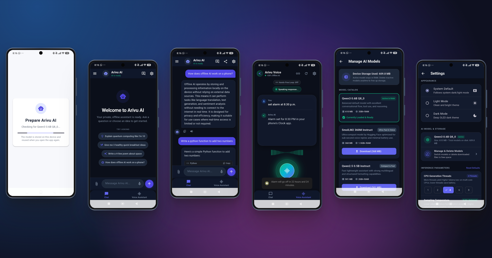
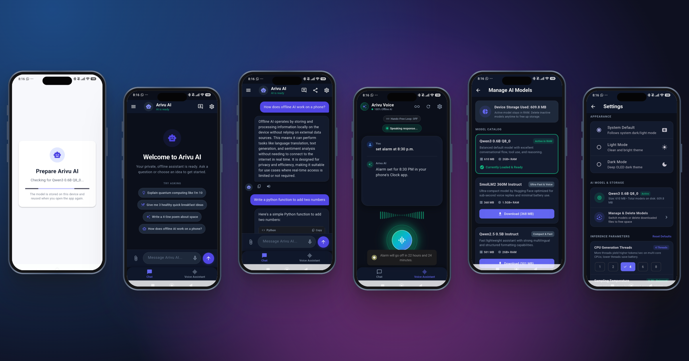

# Arivu AI (ಅರಿವು AI)

<p align="center">
  
  
  
  
</p>

Arivu AI (from the Kannada word *ಅರಿವು*, meaning awareness, insight, and consciousness) is a Flutter-based local AI assistant that runs quantized GGUF language models directly on mobile CPU with zero cloud dependencies and 100% offline privacy.

> [!IMPORTANT]
> **Internet Connectivity Requirement**:
> An active internet connection is required **only once** to download your chosen model weights from Hugging Face (first launch or when downloading an alternate model from Settings).
> Once downloaded, the model is cached in private local app storage, and Arivu AI operates **100% offline** — all text generation, voice assistant loops, local document Q&A (RAG), alarms, reminders, calculator, and device tools run locally with zero network calls.

## Overview

The app boots with an on-device language model (supporting SmolLM2-360M, SmolLM2-1.7B, Qwen2.5-0.5B, Qwen3-0.6B, and Qwen2.5-1.5B) loaded via `llamadart` / llama.cpp. On first launch, a model setup screen checks for a cached model, downloads it from Hugging Face if needed (requires internet), validates supply-chain cryptographic digests, and reports download progress. Once loaded, prompts, document search, and voice interactions are evaluated entirely on-device without internet access.

## App Preview

<p align="center">
  
  <br>
  <em><b>Android Showcase</b>: Real-time on-device chat with syntax-highlighted code blocks, hands-free voice assistant with 24-band mic waveform equalizer, and searchable chat history drawer.</em>
</p>
<br>

<p align="center">
  
  <br>
  <em><b>iOS Showcase</b>: Offline document Q&A (Local RAG for PDF/TXT/MD), multi-model storage manager with on-device hot-swapping, and CPU hardware inference tuning in Settings.</em>
</p>

## Features

- **Local-first AI Chat**: Real-time streaming token generation with full SQLite conversation history persistence.
- **Voice Assistant & Hands-Free Mode**: Conversational voice pipeline (STT ➔ on-device LLM ➔ low-latency streaming TTS) with an animated glowing orb, rotating ambient rings, live audio waveform equalizer, and auto-continuous hands-free loop with silence detection and tap-to-interrupt.
- **Offline Device Action Tools & Registry**:
  - 🧩 **Central Tool Registry**: Unified, extensible architecture (`PocketTool` contract + `ToolRegistry`) dispatching instant device commands without LLM latency or hallucination.
  - ⏰ **Native Android Clock Alarms & Timers**: Set, stop, or dismiss system alarms and countdown timers in the phone's native Clock app via Android intents (*"Set an alarm for 7:30 AM"*, *"Stop the alarm"*, *"Set a timer for 15 minutes"*, *"Cancel timer"*).
  - 🔋 **Battery Diagnostics**: Check live battery percentage and charging status completely offline (*"What's my battery percentage?"*, *"Check battery status"*).
  - 🔦 **Flashlight / Torch Control**: Turn on, turn off, or toggle the device flashlight completely offline (*"Turn on flashlight"*, *"Flashlight off"*).
  - 📅 **Scheduled Reminders**: Natural language reminder alerts scheduled with `flutter_local_notifications` and persisted to SQLite (*"Remind me to drink water in 10 minutes"*).
  - 🧮 **Deterministic Offline Calculator**: Exact arithmetic evaluation, percentages, powers, and roots evaluated in <1ms without LLM hallucination (*"What is 15% of 80?"*, *"Calculate 1500 / 12"*, *"2 to the power of 8"*).
  - 🚀 **Application Launcher**: Instant app opening via Android intents (*"Open YouTube"*, *"Launch Camera"*, *"Open WhatsApp"*, *"Open Maps"*, *"Open Browser"*, *"Open Spotify"*).
  - ⚙️ **System Settings Shortcuts**: Direct navigation to Android settings panels without searching (*"Open Wi-Fi settings"*, *"Open Bluetooth"*, *"Open Display settings"*, *"Volume settings"*).
- **Offline Document Chat (Local RAG)**: Attach local `.pdf`, `.txt`, and `.md` files directly into chat via the paperclip button. The app extracts text using pure Dart `syncfusion_flutter_pdf`, chunks text semantically with overlap, and performs instant in-memory BM25 relevance retrieval to ground LLM answers with zero network calls and zero cloud leaks.
- **Inference Parameters & Hardware Tuning**: Fine-tune CPU generation threads (1, 2, 4, 6, 8), sampling temperature (0.0 to 1.0 with Strict/Balanced/Creative badge), context window size (1024, 2048, 4096 tokens), and max generation tokens (128, 256, 512, 1024) directly from Settings. Parameter modifications are persisted to disk (`inference_config.json`), dynamically re-applied to active models without app restart, and support a one-tap "Reset Defaults" action.
- **Conversation Search & Chat Export**: Instant keyword search across chat titles and message contents in the history drawer with message snippet previews. Export conversations as Markdown (`.md`) files, copy formatted transcripts to clipboard, or share conversations directly through the native system share sheet.
- **Multi-Model Manager & Storage Control**: Select, hot-swap, and delete models on-device (SmolLM2-360M, SmolLM2-1.7B, Qwen2.5-0.5B, Qwen3-0.6B, Qwen2.5-1.5B). Inactive models stay on disk for instant offline switching, with one-tap deletion from Settings to reclaim phone storage. Model catalog is decoupled into `assets/models/model_catalog.json` as the single source of truth.
- **Zero-Cloud Privacy & Security**: 100% on-device CPU inference (no prompt or conversation data leaves your phone), enforced on-device speech recognition (`onDevice: true`), sandboxed local SQLite database with `android:allowBackup="false"` (no automated cloud or ADB extraction), zero telemetry or tracking SDKs, and a one-tap permanent "Wipe All Chat History" in Settings.
- **Dynamic Role-Tailored System Prompts**: Specialized persona instructions optimized for text chat (markdown/bullets) vs. voice mode (concise spoken sentences without emojis or asterisks).
- **Rich Markdown & Syntax Highlighting**: Assistant responses render formatted Markdown (headers, bullet lists, blockquotes, tables) with dedicated syntax-highlighted code blocks, language badge tags, horizontal scroll, and an animated "Copy" button.
- **Riverpod Theme Engine**: Complete light and dark mode support with system default following, controllable via dedicated Settings.
- **Speech Input & Synthesis**: Speech recognition and natural speech playback via `speech_to_text` and `flutter_tts`; availability depends on the device's configured speech services.
- **Automatic Model Download & Caching**: The GGUF model is downloaded once over the internet, verified against its GGUF header and SHA-256 checksum, and reused permanently offline on subsequent launches.
- **On-Device Inference**: All token generation runs locally on mobile CPU. Internet connection is required **only** during the initial model download.
- **Diagnostics & Telemetry**: Logs TTFT (Time-To-First-Token), visible characters/words per second, and inference latency.

## How it works

1. **Storage Check**: The model setup screen checks the application support directory for a cached GGUF model.
2. **One-Time Model Download (Internet Required)**: If no valid model is present, the app downloads the GGUF binary from Hugging Face via Dio with live percentage and byte progress reporting. *(This is the only phase where an internet connection is used).*
3. **Integrity & Checksum Verification**: The downloaded file is validated for its GGUF binary header (`0x47, 0x47, 0x55, 0x46`) and verified against cryptographic SHA-256 digests before atomic storage.
4. **100% Offline Inference**: The app initializes `llamadart` (llama.cpp) in local memory and opens chat. All future launches, prompts, voice sessions, local document RAG queries, and device actions execute entirely offline without internet.

## Requirements

- Flutter SDK 3.38.0 or newer (Dart 3.10.7 or newer)
- Android Studio / Android SDK (Min SDK 26, Android 8.0+)
- An Android device or emulator with 2 GB+ RAM (4 GB+ recommended for 1.5B+ models)
- **Active Internet Connection**: Strictly required for the initial model download from Hugging Face CDN (or when downloading additional models in Settings).
- **Device Storage**: 400 MB to 1.5 GB of free storage depending on the chosen model:
  - *SmolLM2 360M Instruct*: ~386 MB
  - *Qwen2.5 0.5B Instruct*: ~524 MB
  - *Qwen3 0.6B Q8_0 (Default)*: ~639 MB
  - *Qwen2.5 1.5B Instruct*: ~1.03 GB
  - *SmolLM2 1.7B Instruct (4-bit)*: ~1.05 GB

## Getting started

### 1. Clone the repository

```bash
git clone https://github.com/SubramanyaKS/ArivuAI.git
cd ArivuAI
```

### 2. Install dependencies

```bash
flutter pub get
```

### 3. Run the app

```bash
flutter run
```

## Project structure and documentation

```text
lib/       # Flutter app, feature screens, services, and device integrations
test/      # Widget and unit tests
assets/    # App icon and other bundled assets
```

For the full source layout, dependency roles, runtime flows, data storage, and
the architecture diagram, see the [developer documentation](docs/README.md)
and [architecture guide](docs/architecture.md).


## Roadmap

Arivu AI is actively evolving towards a full-featured offline assistant:
- [x] **Offline Device Tools & Central Registry**: Flashlight / torch controls, battery diagnostics, scheduled reminders, and native alarms & timers routed through `ToolRegistry`.
- [x] **Offline Alarms & Timers**: Trigger system clock alarms and countdown timers via native Android intents directly from voice or chat commands.
- [x] **Low-Latency Streaming TTS**: Sentence-by-sentence audio playback for instant voice replies.
- [x] **Auto-Continuous Conversation & Barge-in**: Hands-free conversation loop with silence timeout, verbal exit detection, and tap-to-interrupt.
- [x] **Multi-Model Catalog & Storage Manager**: Choose, hot-swap, and delete GGUF models on-device (SmolLM2-360M, SmolLM2-1.7B, Qwen2.5-0.5B, Qwen3-0.6B, Qwen2.5-1.5B) directly in Settings.
- [x] **Live Mic Amplitude Equalizer & Visualizer**: 24-band animated waveform bars and glowing orb dynamically scaled by real-time microphone RMS volume.
- [x] **Zero-Cloud Privacy & Security**: Enforced on-device speech recognition (`onDevice: true`), `android:allowBackup="false"`, zero telemetry, and permanent data wipe in Settings.
- [x] **Offline Document Chat (Local RAG)**: Private on-device Q&A for local PDFs, Markdown, and notes via pure Dart BM25 retrieval.
- [x] **Markdown & Code Highlighting**: Rich formatting, syntax highlighting, language badges, and one-tap copy button in chat.
- [x] **Conversation Search & Chat Export**: Search past chat titles and messages with snippet previews; export conversations as Markdown (`.md`) or share via system share sheet.
- [x] **Inference Parameters & Hardware Tuning**: Fine-tune CPU generation threads, sampling temperature slider, context window size, and max generation token limits directly in Settings with live dynamic reload.

## Model behavior & Storage

By default, the setup screen downloads `Qwen3-0.6B-Q8_0.gguf` on first launch (requiring an active internet connection) and caches it in the app support directory under `models/`. The service validates the GGUF binary magic header and computes a streaming cryptographic SHA-256 digest to verify supply-chain model integrity before loading weights into memory. 

Once downloaded, the model operates **100% offline**. Users can hot-swap models or download lighter (SmolLM2 360M) or deeper (SmolLM2 1.7B, Qwen2.5 1.5B) alternatives directly from the Settings screen. Subsequent launches reuse the cached weights with zero network overhead. Model loading latency, token throughput, and file sizes are written to debug logs.

## Inference package migration

The inference service uses `llamadart` for model loading and streamed generation; `llama_flutter_android` has been removed. The existing Dio-based model download, progress reporting, GGUF validation, and cache location are unchanged. `llamadart` requires Dart 3.10.7 or newer and Flutter 3.38.0 or newer.

## Contributing

Contributions are welcome! Please read our [Contributing Guidelines](CONTRIBUTING.md) for details on code style, testing requirements, and step-by-step instructions on implementing new offline device tools and models.

## Security & Privacy Policy

Arivu AI operates on a strictly air-gapped, zero-cloud architecture. For vulnerability disclosure and details on our local threat model, see [SECURITY.md](SECURITY.md).

## Changelog

For a complete version history and milestone breakdown, see [CHANGELOG.md](CHANGELOG.md).

## Acknowledgments & Credits

Arivu AI is built upon the foundational work of the open-source AI and Flutter communities:

- **[llama.cpp](https://github.com/ggerganov/llama.cpp)** by [Georgi Gerganov](https://github.com/ggerganov) & contributors — for the revolutionary high-performance C++ LLM inference engine.
- **[llamadart](https://pub.dev/packages/llamadart)** — for the clean Dart FFI bindings linking Flutter to native `llama.cpp`.
- **Model Authors & Providers**:
  - **[Qwen Team / Alibaba Cloud](https://huggingface.co/Qwen)** for the open-weight Qwen3 and Qwen2.5 multilingual model family.
  - **[Hugging Face](https://huggingface.co/HuggingFaceTB)** for the compact, high-efficiency SmolLM2 mobile reasoning models.
- **Key Flutter & Dart Libraries**:
  - **[Syncfusion](https://pub.dev/packages/syncfusion_flutter_pdf)** for pure Dart PDF parsing enabling private, zero-cloud RAG.
  - **[Riverpod](https://riverpod.dev/)** for robust reactive state management.
  - **[flutter_local_notifications](https://pub.dev/packages/flutter_local_notifications)** & **[android_intent_plus](https://pub.dev/packages/android_intent_plus)** for native system clock alarms, timers, and scheduled reminders.
  - **[flutter_markdown_plus](https://pub.dev/packages/flutter_markdown_plus)** & **[flutter_highlighter](https://pub.dev/packages/flutter_highlighter)** for rich markdown rendering and syntax highlighting.
  - **[speech_to_text](https://pub.dev/packages/speech_to_text)** & **[flutter_tts](https://pub.dev/packages/flutter_tts)** for on-device voice dictation and low-latency audio synthesis.
  - **[battery_plus](https://pub.dev/packages/battery_plus)** & **[torch_light](https://pub.dev/packages/torch_light)** for offline hardware diagnostics and control.
- **Design & Visuals**:
  - Device mockup collages crafted with **[MockSnap](https://app.mocksnap.app/)**.

## License

This project is licensed under the Apache License, Version 2.0. See the [LICENSE](LICENSE) file for the full license text and additional AI/hardware safety terms.
