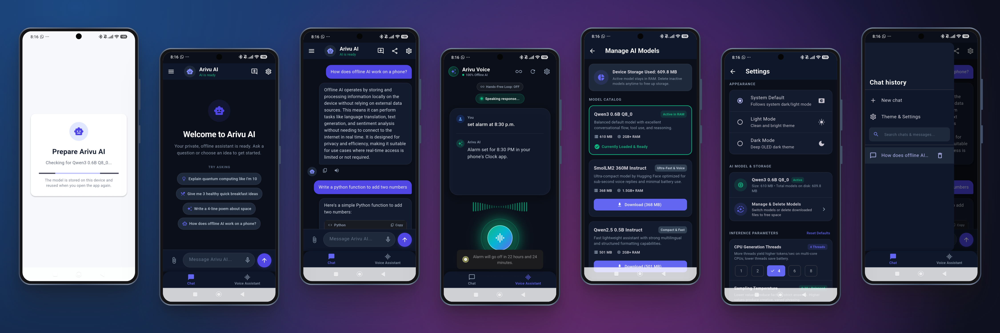
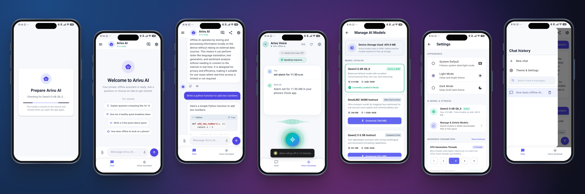

# Arivu AI Developer Documentation

Welcome to the Arivu AI developer documentation. Arivu AI is an offline-first mobile AI assistant built with Flutter and embedded `llama.cpp` (`llamadart`).

> [!IMPORTANT]
> **Internet Connectivity Requirement**:
> An active internet connection is required **only once** to download your chosen model weights from Hugging Face CDN (first launch or when downloading an alternate model from Settings).
> Once downloaded, the model is cached in private local app storage, and Arivu AI operates **100% offline** — all text generation, voice assistant loops, local document Q&A (RAG), alarms, reminders, calculator, and device tools run locally with zero network calls.

---

## 📚 Documentation Index

1. **[Architecture & Technical Specifications](architecture.md)**
   - High-Level Multi-Tier Component Diagram
   - Model Preparation, Validation, and Lifecycle Flow
   - Tool Interception & Deterministic Execution Pipeline
   - Full-Duplex Voice Assistant Sequence Diagram
   - SQLite Schema & Entity-Relationship Diagram (ERD)
   - Android Permissions & Hardware Guard Matrix

2. **[Project Overview & Quickstart](../README.md)**
   - Prerequisites & Setup Guide
   - Feature Highlights
   - Build & Run Instructions

3. **[Future Project Roadmap](FUTURE_ROADMAP.md)**
   - Completed Milestones (Voice Assistant, Tool Registry, Multi-Model Manager, Local RAG)
   - Upcoming Engineering Phases (Hardware Acceleration, Search & Export)

4. **[Contribution Guidelines](../CONTRIBUTING.md)**
   - Developer environment setup and testing commands
   - Step-by-step guide for adding new offline tools and models

5. **[Changelog & Version History](../CHANGELOG.md)**
   - Comprehensive release history and milestone changelog

6. **[Security Policy & Zero-Cloud Threat Model](../SECURITY.md)**
   - Local air-gapped security model and vulnerability reporting procedure

7. **[App Screenshots & UI Showcase](screenshots/)**
   - High-resolution mockups for Android and iOS

---

## 📸 App Preview

<p align="center">
  
  <br>
  <em><b>Android Showcase</b>: Real-time on-device chat with syntax-highlighted code blocks, hands-free voice assistant with 24-band mic waveform equalizer, and searchable chat history drawer.</em>
</p>
<br>

<p align="center">
  
  <br>
  <em><b>iOS Showcase</b>: Offline document Q&A (Local RAG for PDF/TXT/MD), multi-model storage manager with on-device hot-swapping, and CPU hardware inference tuning in Settings.</em>
</p>

---

## 🗂️ Clean Source Directory Structure

```text
assets/
└── models/
    └── model_catalog.json              # Decoupled single source of truth for model specifications

docs/
├── architecture.md                     # Technical architecture & sequence diagrams
├── FUTURE_ROADMAP.md                   # Roadmap & completed milestones
├── README.md                           # Documentation index & developer guide
└── screenshots/                        # App mockup collages & UI previews
    ├── arivu_screenshot_android.png
    └── arivu_screenshot_iphone.png

lib/
├── main.dart                           # Flutter bindings, notification & model catalog initialization
├── app.dart                            # MaterialApp root, route setup & theme definitions
│
├── provider/
│   └── theme_provider.dart             # Riverpod ThemeNotifier (System / Light / Dark)
│
├── llm/
│   └── tool_definitions.dart           # Offline function schemas for reminder & torch
│
├── tools/
│   ├── pocket_tool.dart                # Abstract PocketTool contract (name, definition, tryExecute)
│   ├── tool_registry.dart              # Central tool dispatcher & schema aggregation hub
│   ├── alarm_tool.dart                 # Native Android Clock alarms & timers via Intent Plus
│   ├── app_launcher_tool.dart          # Launch Camera, YouTube, Maps, WhatsApp, etc.
│   ├── battery_tool.dart               # Battery level & charging status diagnostics
│   ├── calculator_tool.dart            # Exact offline arithmetic, percentage & power evaluator
│   ├── device_settings_tool.dart       # Wi-Fi, Bluetooth, Display, Sound settings shortcuts
│   ├── remainder_tools.dart            # Local notification & alarm scheduling service
│   ├── reminder_parser.dart            # Offline natural language regex intent extractor
│   └── torch_tool.dart                 # Device camera flashlight hardware controller
│
├── features/
│   ├── model/
│   │   ├── models/
│   │   │   ├── model_spec.dart         # Model entity (id, size, url, RAM reqs)
│   │   │   ├── model_catalog.dart      # Curated catalog (SmolLM2, Qwen2.5, Qwen3)
│   │   │   └── inference_config.dart   # Inference parameters (threads, context, temp, maxTokens)
│   │   └── presentation/
│   │       └── model_setup_screen.dart # Download progress & model preparation screen
│   │
│   ├── home/presentation/
│   │   ├── home_screen.dart            # Tab scaffold & bottom navigation bar
│   │   └── welcome_screen.dart         # Initial onboard welcome widget
│   │
│   ├── document/
│   │   ├── models/
│   │   │   └── attached_document.dart  # Document metadata, chunks & token estimations
│   │   └── service/
│   │       └── document_service.dart   # File picking, PDF/TXT/MD parsing & BM25 retrieval
│   │
│   ├── chat/
│   │   ├── models/
│   │   │   ├── chat_message.dart       # Message entity (role, content, timestamp)
│   │   │   └── performance_metrics.dart# Diagnostics (TTFT, tokens/sec, throughput)
│   │   ├── presentation/
│   │   │   └── chat_screen.dart        # Chat UI, document chip, history drawer & dispatcher
│   │   ├── service/
│   │   │   ├── chat_database.dart      # SQLite database (conversations, messages, reminders)
│   │   │   ├── chat_export_service.dart# Markdown formatting, .md file generator & share sheet
│   │   │   ├── chat_utils.dart         # Context pruning & title truncation utilities
│   │   │   ├── local_ai_service.dart   # LlamaEngine wrapper, streaming & prompt manager
│   │   │   └── think_filter.dart       # DeepSeek/Qwen <think> tag stream sanitizer
│   │   └── widgets/
│   │       ├── chat_empty_widget.dart  # Empty state with ready-to-test starter prompts
│   │       ├── code_block_widget.dart  # Syntax-highlighted code block with copy button
│   │       ├── markdown_code_builder.dart # Custom Markdown code syntax element builder
│   │       └── prompt_suggestion.dart  # Interactive suggestion chip component
│   │
│   ├── assistant/presentation/
│   │   ├── voice_assistant_screen.dart # Interactive voice UI with animated orb & wave bars
│   │   └── voice_utils.dart            # Spoken text sanitization & visual state styling
│   │
│   └── settings/presentation/
│       ├── settings_screen.dart        # Appearance & model storage settings
│       └── manage_models_screen.dart   # Model catalog, hot-swap & delete manager
│
└── utils/
    ├── constant.dart                   # GGUF download URL, filename & storage constants
    └── theme.dart                      # Core color palettes & text styling rules
```

---

## ⚙️ Core Technology Stack

| Domain | Technology / Package | Role & Responsibility |
|---|---|---|
| **Language & Framework** | Dart 3.10+ / Flutter 3.38+ | Cross-platform core framework |
| **Local Model Engine** | `llamadart` (`llama.cpp`) | On-device 4-thread CPU GGUF inference |
| **Model Download & Cache** | `dio` + `path_provider` | Initial one-time download with progress (internet required) & local file storage |
| **State Management** | `flutter_riverpod` | Unified theme state management |
| **Persistence** | `sqflite` + `path` | Local SQLite database (`chat_history.db`) |
| **Speech-to-Text** | `speech_to_text` | Real-time speech dictation and transcription |
| **Text-to-Speech** | `flutter_tts` | Offline voice audio synthesis |
| **Notifications & Alarms** | `flutter_local_notifications` + `timezone` | Exact alarms, device reboots & reminder alerts |
| **Device Battery & Power** | `battery_plus` | Hardware battery level & charging state |
| **Hardware Flashlight** | `torch_light` | Device camera LED control |
| **System Alarms & Timers** | `android_intent_plus` | Android native Clock app intent dispatching |
| **Integrity & Security** | `crypto` | Streaming SHA-256 model supply-chain verification |
| **Markdown Rendering** | `flutter_markdown_plus` + `markdown` | Markdown parsing for assistant replies |
| **Code Syntax Highlighting** | `flutter_highlighter` | Language syntax highlighter & themes |
| **Document Text Extraction** | `syncfusion_flutter_pdf` | Pure Dart PDF text extraction for local RAG |
| **Document Picker** | `file_picker` | Native local file selection (.pdf, .txt, .md) |
| **System Share & Export** | `share_plus` | Platform native share sheet for text and .md files |

---

## 🧪 Local Quality & Testing

To ensure stability across the pipeline, run the project analysis and test suite:

```bash
# 1. Fetch dependencies
flutter pub get

# 2. Run static analysis (enforces lint rules and type safety)
flutter analyze

# 3. Execute unit and widget tests
flutter test
```
