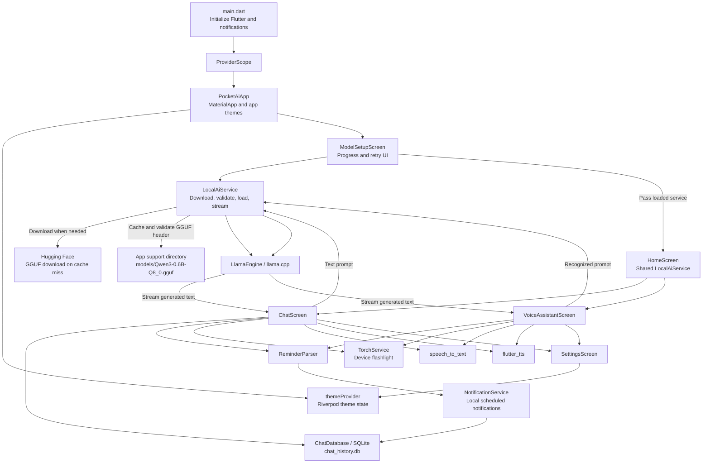

# Architecture

Pocket AI is organized as a Flutter UI with feature-oriented screens, a shared
local inference service, and local integrations for persistence and device
actions.

## Component diagram

## Startup and model lifecycle

1. `main()` initializes Flutter bindings and awaits
   `NotificationService.instance.initialize()`, which sets up local
   notifications and requests the relevant Android notification/alarm
   permissions.
2. The app is started inside a Riverpod `ProviderScope`. `PocketAiApp` watches
   `themeProvider` and opens `ModelSetupScreen`.
3. `ModelSetupScreen` creates a `LocalAiService` and calls `loadModel()`.
4. The service looks for the configured model in the app support directory. A
   cached file is reused if its first four bytes are `GGUF`. Otherwise, the
   previous incomplete file is removed, Dio downloads to a `.part` file, the
   header is checked, and the file is renamed into place.
5. The service loads the model through `LlamaEngine` with a 2,048-token context
   and four threads. On success, the setup screen passes this same service
   instance to `HomeScreen`; both the chat and voice tabs reuse it.

The configured model URL and filename are in
[`lib/utils/constant.dart`](../lib/utils/constant.dart). The current loader checks
the GGUF magic header, not a checksum or full model integrity.

## Chat flow

1. `ChatScreen` loads the latest conversation and its messages from
   `ChatDatabase`.
2. On send, the user message is saved to SQLite before generation begins.
3. Reminder and flashlight commands are checked locally first. Matching
   commands are executed directly and do not go through model inference.
4. Other prompts are combined with the relevant conversation context and passed
   to `LocalAiService.askStream()`.
5. Generated chunks pass through `ThinkFilter`, are displayed as they arrive,
   then the completed assistant response is saved to SQLite.

The chat system prompt allows normal text formatting. Chat generation defaults
to a maximum of 256 tokens.

## Voice flow

1. `VoiceAssistantScreen` captures speech using `speech_to_text`.
2. The recognized prompt is checked by the same reminder and flashlight
   handlers as text chat.
3. Other prompts go to the shared `LocalAiService` with the voice-specific
   system prompt and a 120-token generation limit.
4. The generated response is cleaned for spoken output and read using
   `flutter_tts`.

The voice screen handles speech recognition and synthesis as platform plugin
integrations. Their offline availability and behavior depend on the device's
installed/configured speech services.

## Persistence and device integrations

`ChatDatabase` lazily opens `chat_history.db` using `sqflite`. The database
contains:

- `conversations` and `messages`; deleting a conversation cascades to its
  messages.
- `reminders`, which stores reminder title, schedule time, and completion state.

`ReminderParser` recognizes supported reminder phrases before inference.
`NotificationService` schedules local notifications and then attempts to store
reminder metadata in SQLite. Reminder notification scheduling is independent of
model inference.

`TorchService` recognizes flashlight/torch phrases and uses `torch_light` to
control the device. Both the chat and voice screens invoke these handlers
directly.

## State and UI

`PocketAiApp` applies the light and dark themes from `AppTheme`. The
`ThemeNotifier` is a Riverpod `Notifier` whose initial mode follows the system;
`SettingsScreen` lets users choose system, light, or dark mode. Theme selection
is currently in-memory and is not persisted between app launches.

`HomeScreen` owns the bottom navigation between `ChatScreen` and
`VoiceAssistantScreen`. It constructs both with the already-loaded inference
service.
