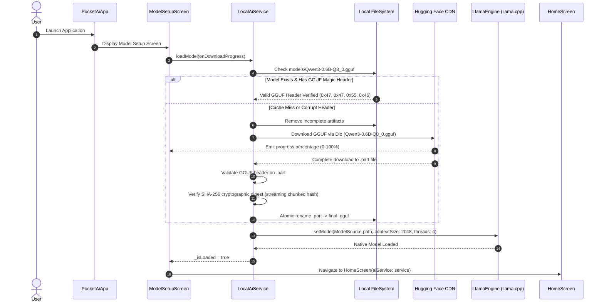
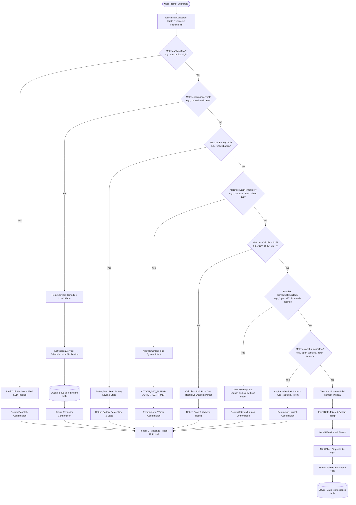
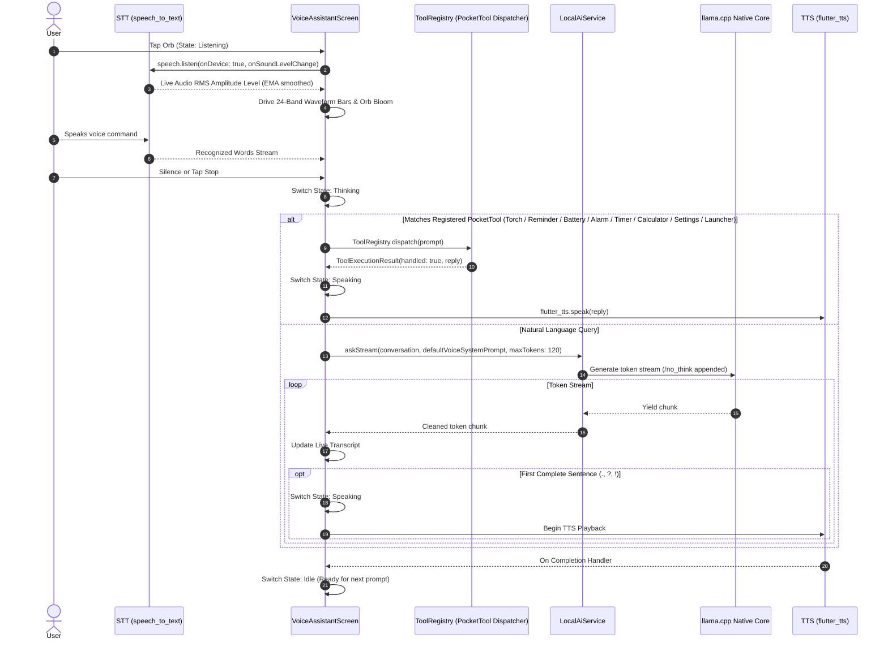
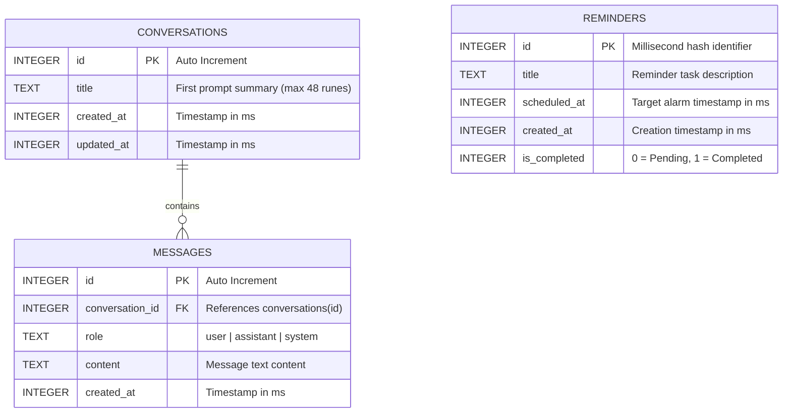
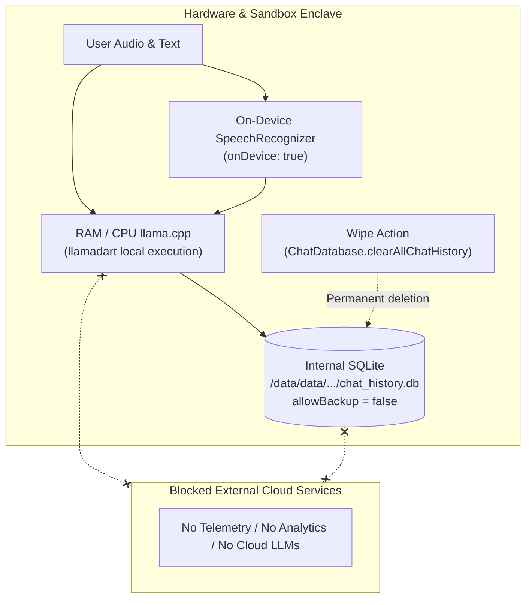
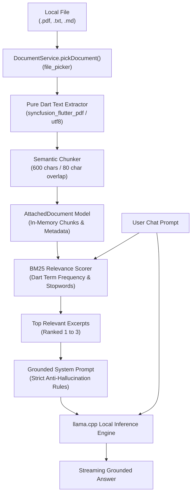
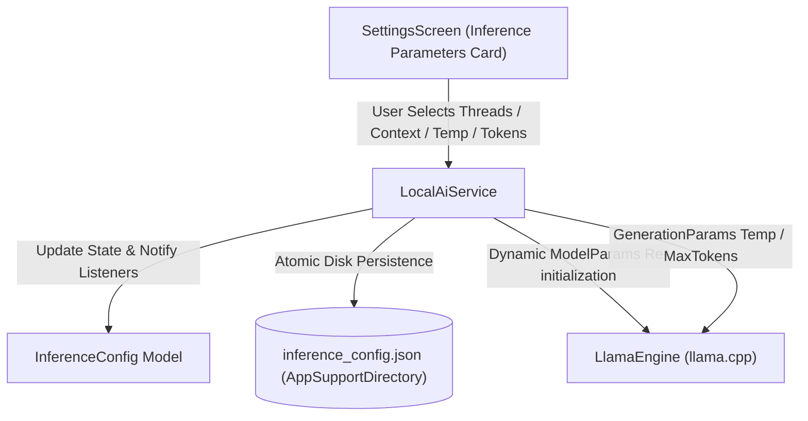

# Pocket AI — System Architecture & Technical Specifications

Pocket AI is architected as an offline-first, on-device mobile AI assistant. It integrates native embedded `llama.cpp` machine learning inference via `llamadart`, device-native hardware control, local SQLite data persistence, and an interactive voice pipeline.

---

## 1. High-Level Architecture Overview

```mermaid
flowchart TD
    subgraph UI_Layer ["Presentation & UI Layer"]
        App["PocketAiApp<br/>(Theme & Navigation Root)"]
        SetupScreen["ModelSetupScreen<br/>(Download & Initialization UI)"]
        HomeScreen["HomeScreen<br/>(Tab Shell Navigation)"]
        ChatScreen["ChatScreen<br/>(MarkdownBody, CodeBlockWidget & Prompts)"]
        VoiceScreen["VoiceAssistantScreen<br/>(Orb, Waves & Hands-Free Flow)"]
        SettingsScreen["SettingsScreen<br/>(Theme, Model Storage & Settings)"]
        ManageModelsScreen["ManageModelsScreen<br/>(Model Catalog, Hot-Swap & Delete UI)"]
    end

    subgraph State_Layer ["State Management"]
        RiverpodScope["ProviderScope"]
        ThemeState["themeProvider<br/>(ThemeNotifier: System / Light / Dark)"]
    end

    subgraph Service_Layer ["Core Services & Tool Orchestration"]
        AI["LocalAiService<br/>(Model Manager & Inference Streamer)"]
        Think["ThinkFilter<br/>(CoT / &lt;think&gt; Stream Sanitizer)"]
        ChatUtils["ChatUtils<br/>(Context Pruning & Title Truncation)"]
        VoiceUtils["VoiceUtils<br/>(Spoken Text Sanitizer & State Styling)"]
        Registry["ToolRegistry<br/>(Central Tool Dispatcher & Schema Aggregator)"]
        PocketContract["PocketTool Contract<br/>(Polymorphic Tool Execution)"]
        ReminderHandler["ReminderTool<br/>(Regex / Deterministic Intent Matcher)"]
        Notifier["NotificationService<br/>(Timezone-Aware Scheduled Alarms)"]
        Torch["TorchTool<br/>(Camera Flash Hardware Controller)"]
        Battery["BatteryTool<br/>(Level & Charging Status Reader)"]
        AlarmTimer["AlarmTimerTool<br/>(Native Android Clock & Timer Intent Dispatcher)"]
        Calculator["CalculatorTool<br/>(Deterministic Offline Math & Percentage Parser)"]
        DevSettings["DeviceSettingsTool<br/>(Wi-Fi, Bluetooth, Display, Sound Panels)"]
        AppLauncher["AppLauncherTool<br/>(Camera, YouTube, Maps, WhatsApp Launchers)"]
        DocService["DocumentService<br/>(Text Extraction, Chunking & BM25 Retrieval)"]
        ExportService["ChatExportService<br/>(Markdown Formatter & Share Sheet)"]
    end

    subgraph Native_Layer ["Native Platforms & Device Hardware"]
        LlamaEngine["llamadart / llama.cpp<br/>(C++ Engine: CPU / 4 Threads)"]
        SQLite["SQLite Database<br/>(chat_history.db via sqflite)"]
        LocalFS["Local App Storage<br/>(models/Qwen3-0.6B-Q8_0.gguf)"]
        STT["Device Speech Recognizer<br/>(speech_to_text)"]
        TTS["Device Speech Synthesizer<br/>(flutter_tts)"]
        AlarmMgr["Android AlarmManager & Receivers<br/>(ScheduledNotificationReceiver)"]
        CameraFlash["Hardware Flash LED<br/>(torch_light)"]
        BatteryHW["Battery Hardware & Broadcast<br/>(battery_plus)"]
        ClockApp["Android System Clock App<br/>(ACTION_SET_ALARM / ACTION_SET_TIMER)"]
    end

    subgraph External_Network ["Remote Services (One-Time Only)"]
        HF["Hugging Face Hub<br/>(Initial GGUF Model Download)"]
    end

    App --> RiverpodScope
    RiverpodScope --> ThemeState
    App --> SetupScreen
    SetupScreen -->|On Cache Miss| HF
    HF -->|Stream .part & Validate Header| LocalFS
    LocalFS -->|Load Weights| LlamaEngine
    SetupScreen -->|Model Ready: Pass LocalAiService| HomeScreen
    
    HomeScreen --> ChatScreen
    HomeScreen --> VoiceScreen
    SettingsScreen -.->|Mutates State| ThemeState
    SettingsScreen --> ManageModelsScreen
    ManageModelsScreen -->|Switch / Delete Model| AI
    ThemeState -.->|Rebuilds UI| App

    ChatScreen -->|Context Window| ChatUtils
    ChatScreen -->|Intercept Intent| Registry
    ChatScreen -->|Attach & Grounded RAG| DocService
    ChatScreen -->|Export & Share| ExportService
    ChatScreen -->|Fallback / General Query| AI

    VoiceScreen -->|Voice Input| STT
    VoiceScreen -->|Speech Cleansing| VoiceUtils
    VoiceScreen -->|Intercept Intent| Registry
    VoiceScreen -->|Fallback / General Query| AI
    VoiceScreen -->|Read Aloud| TTS

    Registry --> PocketContract
    PocketContract --> Torch
    PocketContract --> ReminderHandler
    PocketContract --> Battery
    PocketContract --> AlarmTimer
    PocketContract --> Calculator
    PocketContract --> DevSettings
    PocketContract --> AppLauncher

    AI --> Think
    AI --> LlamaEngine
    LlamaEngine -->|Token Chunks| Think
    Think -->|Sanitized Stream| ChatScreen
    Think -->|Sanitized Stream| VoiceScreen

    ReminderHandler -->|Schedule Reminder| Notifier
    Notifier --> AlarmMgr
    Notifier -->|Record Reminder| SQLite
    Torch --> CameraFlash
    Battery --> BatteryHW
    AlarmTimer -->|Launch Intent| ClockApp
    ChatScreen -->|Persist Turn| SQLite
```

---

## 2. Model Preparation & Initialization Flow

When Pocket AI launches, it ensures valid weights are present locally before presenting chat or voice interfaces.

---

## 3. End-to-End Chat & Tool Interception Pipeline

User prompts undergo deterministic intent interception via `ToolRegistry` before routing to the LLM. This prevents hallucination for device actions, ensures immediate execution, and conserves mobile battery.

---

## 4. Full-Duplex Voice Assistant Execution Sequence

The voice pipeline connects Speech-to-Text, intent parsing, on-device streaming LLM inference, and Text-to-Speech synthesis.

---

## 5. Local Data Storage & Schema Design

Pocket AI persists all user conversations, messages, and scheduled tasks in a local SQLite database (`chat_history.db`).

---

## 6. Offline Speech & Hardware Permissions Matrix

| Platform Feature | Android Permission | Fallback / Hardware Guard |
|---|---|---|
| **Audio Dictation** | `android.permission.RECORD_AUDIO` | Checks `speech.initialize()` availability |
| **Scheduled Reminders** | `android.permission.POST_NOTIFICATIONS` | `requestNotificationsPermission()` prompt on Android 13+ |
| **Exact Alarms** | `SCHEDULE_EXACT_ALARM`, `USE_EXACT_ALARM` | Auto-downgrades from `alarmClock` to `exactAllowWhileIdle` |
| **Reboot Persistence** | `RECEIVE_BOOT_COMPLETED` | Handled by `ScheduledNotificationBootReceiver` |
| **Camera Flashlight** | `android.permission.CAMERA` | `TorchLight.isTorchAvailable()` pre-check |
| **Battery Diagnostics** | None (Standard OS Broadcast) | `BatteryTool.getBatteryInfo()` exception guard |
| **Native Alarms & Timers** | `com.android.alarm.permission.SET_ALARM` | Dispatches `ACTION_SET_ALARM`, `ACTION_SET_TIMER`, `ACTION_DISMISS_ALARM`, `ACTION_DISMISS_TIMER`, `ACTION_SHOW_ALARMS` via `android_intent_plus` (`SKIP_UI: true`) |
| **Deterministic Calculator** | None (Pure Dart Execution) | Evaluates arithmetic, percentages & powers in <1ms; gracefully handles division by zero and delegates non-math to LLM |
| **System Settings Shortcuts** | None (Standard Android Intents) | Dispatches `android.settings.*` intents (WIFI, BLUETOOTH, DISPLAY, SOUND, BATTERY) |
| **Application Launcher** | None (Standard Intent Action / Category) | Dispatches launcher intents for Camera, YouTube, Maps, WhatsApp, Chrome, Gallery, Email, Dialer, Messages, Spotify |
| **Local Document Ingestion & RAG** | None (In-Memory File Bytes) | Pure Dart parsing via `syncfusion_flutter_pdf`, boundary chunking & BM25 retrieval without network access |

---

## 7. Zero-Cloud Privacy & Data Security Architecture

Pocket AI enforces an uncompromising zero-cloud privacy architecture across all layers of the stack:

### Key Security Safeguards:
1. **100% On-Device CPU Inference**: All prompt evaluations, token generation, and context management occur exclusively in local process memory via C++ `llama.cpp`. Zero prompt or completion data leaves the phone.
2. **Enforced Local Speech Recognition**: Voice recognition is configured with `onDevice: true`, instructing Android to use local speech recognition packages rather than cloud transcription servers.
3. **Internal Sandboxed Storage & No Cloud Backups**: The SQLite database (`chat_history.db`) is stored in Android's private app directory with `android:allowBackup="false"` in `AndroidManifest.xml`, preventing ADB extraction or Google Drive backups from exposing user messages.
4. **Permanent One-Tap Data Wipe**: The Settings screen provides an atomic `ChatDatabase.clearAllChatHistory()` action that permanently deletes all stored messages and conversations with confirmation guards.
5. **Supply Chain Verification**: Model files downloaded from Hugging Face are verified with binary GGUF magic bytes (`0x47, 0x47, 0x55, 0x46`) and SHA-256 cryptographic checksums before memory loading.
6. **Decoupled Model Catalog**: Model configurations are decoupled into [`assets/models/model_catalog.json`](../assets/models/model_catalog.json) as the single source of truth, loaded asynchronously at application boot.

---

## 8. Offline Document Chat & Local RAG Architecture

Pocket AI features a 100% on-device Retrieval-Augmented Generation (RAG) pipeline for document question answering without external vector databases, Python servers, or cloud embedding APIs:

### Key RAG Pipeline Components:
1. **Zero-Cloud Ingestion**: Files (`.pdf`, `.txt`, `.md`) are read locally into process memory. No document content is uploaded or transmitted over the network.
2. **Pure Dart PDF Parsing**: Powered by `syncfusion_flutter_pdf`, which runs entirely in Dart without platform method channel overhead or native OS PDF dependencies.
3. **Paragraph & Sentence Chunking**: Documents are split along natural paragraph (`\n\n`) and sentence boundaries into ~600 character chunks with 80 character overlap to maintain semantic continuity.
4. **Pure Dart BM25 Retrieval**: Fast (<2ms) in-memory ranking with English stopword filtering and term-frequency scoring over candidate chunks, eliminating heavy ONNX runtime or cloud vector database dependencies.
5. **Strict Grounding & Anti-Hallucination Prompting**: Retrieved excerpts are formatted into a constrained system prompt instructing the local LLM to answer strictly from the excerpts and state clearly if information is absent.

---

## 9. Inference Parameters & Hardware Tuning Architecture

Pocket AI allows users to fine-tune CPU generation and sampling parameters directly on-device to balance throughput, battery consumption, and creativity:

### Configurable Parameters:
1. **CPU Generation Threads**: Selectable between 1, 2, 4, 6, and 8 threads. Dynamic reload updates `ModelParams(numberOfThreads: ...)` on the active engine without app restart. Lower threads conserve battery; higher threads maximize tokens/second on multi-core processors.
2. **Sampling Temperature**: Continuous slider from `0.0` to `1.0` with dynamic semantic labeling:
   - `0.0 - 0.2`: **Strict** (deterministic, factual, code & math)
   - `0.3 - 0.5`: **Balanced** (general conversations & assistance)
   - `0.6 - 1.0`: **Creative** (storytelling, brainstorming, creative writing)
3. **Context Window Size**: Discrete chips for `1024` (Eco / Low RAM), `2048` (Default), and `4096` (Deep / Long Documents). Re-allocates the KV-cache in `LlamaEngine` cleanly on change.
4. **Max Generation Tokens**: Discrete chips for `128`, `256`, `512`, and `1024` tokens per response turn, bounding generation latency.
5. **Reset Defaults Action**: Single tap restores standard configurations (`threads: 4`, `temp: 0.3`, `context: 2048`, `maxTokens: 256`) and persists immediately to disk.

