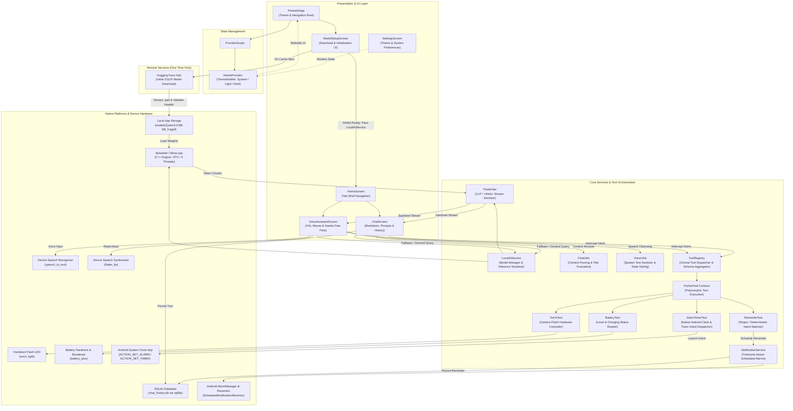
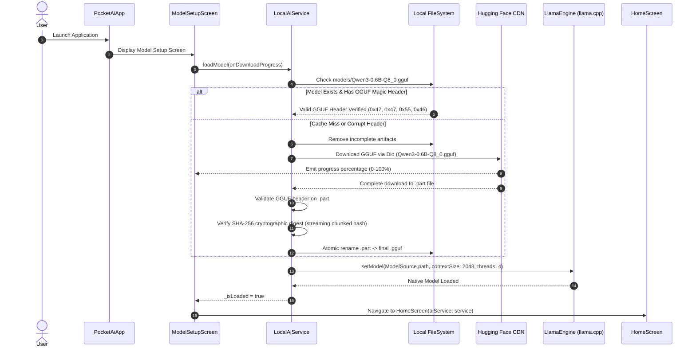
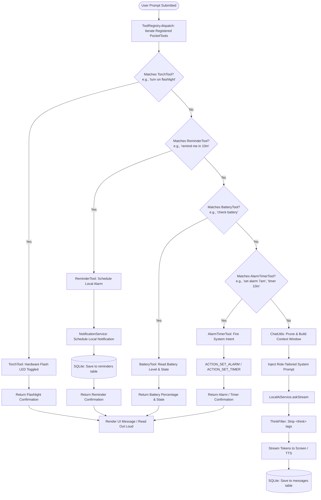
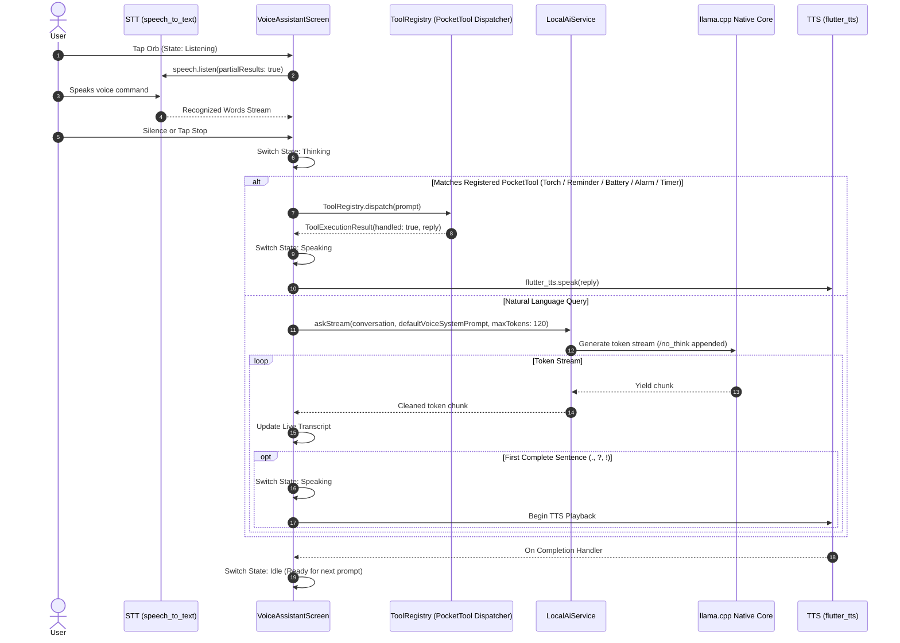
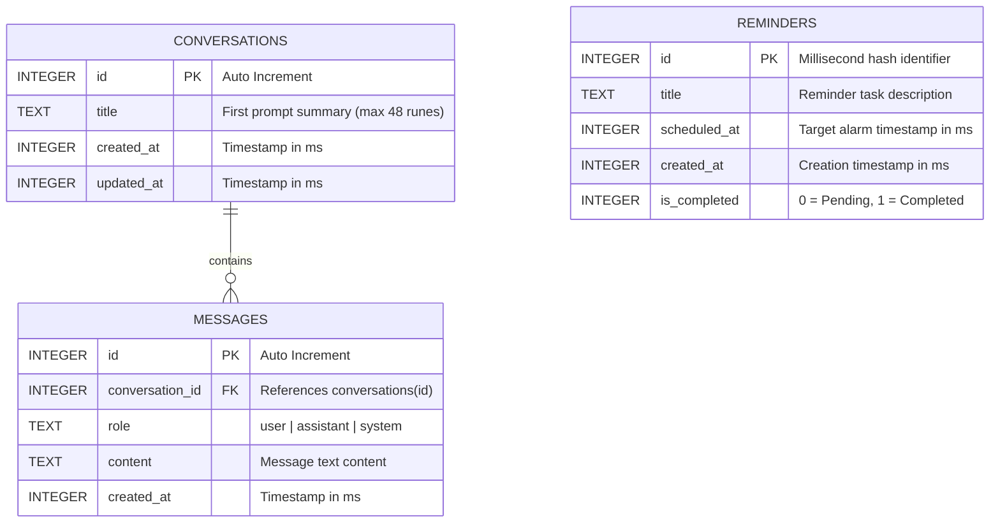

# Pocket AI — System Architecture & Technical Specifications

Pocket AI is architected as an offline-first, on-device mobile AI assistant. It integrates native embedded `llama.cpp` machine learning inference via `llamadart`, device-native hardware control, local SQLite data persistence, and an interactive voice pipeline.

---

## 1. High-Level Architecture Overview

---

## 2. Model Preparation & Initialization Flow

When Pocket AI launches, it ensures valid weights are present locally before presenting chat or voice interfaces.

---

## 3. End-to-End Chat & Tool Interception Pipeline

User prompts undergo deterministic intent interception via `ToolRegistry` before routing to the LLM. This prevents hallucination for device actions, ensures immediate execution, and conserves mobile battery.

---

## 4. Full-Duplex Voice Assistant Execution Sequence

The voice pipeline connects Speech-to-Text, intent parsing, on-device streaming LLM inference, and Text-to-Speech synthesis.

---

## 5. Local Data Storage & Schema Design

Pocket AI persists all user conversations, messages, and scheduled tasks in a local SQLite database (`chat_history.db`).

---

## 6. Offline Speech & Hardware Permissions Matrix

| Platform Feature | Android Permission | Fallback / Hardware Guard |
|---|---|---|
| **Audio Dictation** | `android.permission.RECORD_AUDIO` | Checks `speech.initialize()` availability |
| **Scheduled Reminders** | `android.permission.POST_NOTIFICATIONS` | `requestNotificationsPermission()` prompt on Android 13+ |
| **Exact Alarms** | `SCHEDULE_EXACT_ALARM`, `USE_EXACT_ALARM` | Auto-downgrades from `alarmClock` to `exactAllowWhileIdle` |
| **Reboot Persistence** | `RECEIVE_BOOT_COMPLETED` | Handled by `ScheduledNotificationBootReceiver` |
| **Camera Flashlight** | `android.permission.CAMERA` | `TorchLight.isTorchAvailable()` pre-check |
| **Battery Diagnostics** | None (Standard OS Broadcast) | `BatteryTool.getBatteryInfo()` exception guard |
| **Native Alarms & Timers** | `com.android.alarm.permission.SET_ALARM` | Dispatches `ACTION_SET_ALARM`, `ACTION_SET_TIMER`, `ACTION_DISMISS_ALARM`, `ACTION_DISMISS_TIMER`, `ACTION_SHOW_ALARMS` via `android_intent_plus` (`SKIP_UI: true`) |
